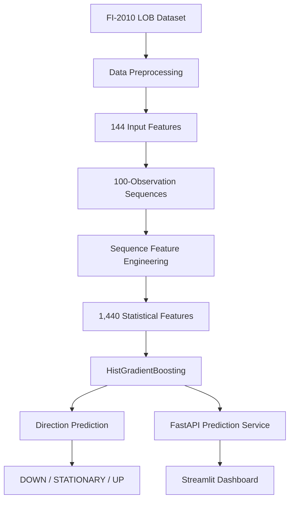

# MOSAIC
### Market Order-flow Sequence Intelligence & Cross-Asset Learning

**A machine learning research project for short-horizon Limit Order Book (LOB) direction classification using sequence-based feature engineering and HistGradientBoosting.**

[](https://www.python.org/)
[](https://scikit-learn.org/)
[](https://pytorch.org/)
[](https://fastapi.tiangolo.com/)
[]()

---

## 1. Project Overview

MOSAIC is a quantitative machine learning research prototype designed to investigate short-term market direction prediction from Limit Order Book data.

The project uses the FI-2010 benchmark dataset to classify future mid-price movement into three categories:

- **DOWN** – downward mid-price movement.
- **STATIONARY** – no significant directional movement.
- **UP** – upward mid-price movement.

The central research question is:

> Can richer statistical representations of historical Limit Order Book sequences improve short-horizon market direction classification compared with simpler sequence summaries?

MOSAIC investigates this through feature engineering, conventional machine learning baselines, Transformer experimentation, chronological validation and official benchmark test evaluation.

## 2. Key Results

The final evaluation compares two sequence-based feature representations using HistGradientBoosting across all nine FI-2010 benchmark folds.

| Metric | Original features | Expanded features |
|---|---:|---:|
| Sequence features | 576 | 1,440 |
| Mean accuracy | 59.13% | **65.41%** |
| Mean macro F1 | 0.5710 | **0.6465** |
| Accuracy standard deviation | 0.0233 | 0.0192 |
| Macro F1 standard deviation | 0.0314 | 0.0250 |

**Main finding:** The expanded 1,440-feature representation improved mean macro F1 by approximately 0.0755 and accuracy by 6.28 percentage points across the nine paired benchmark folds.

Expanded features achieved a higher macro F1 than the original representation on all nine folds.

These are benchmark classification results, not evidence of trading profitability or cross-asset generalisation.

## 3. System Architecture



## 4. Dataset

MOSAIC uses the publicly available **FI-2010 Limit Order Book benchmark dataset**.

The initial experiment uses the NoAuction Z-score dataset.

Dataset characteristics:

- 9 training folds.
- 9 corresponding testing folds.
- 144 input features per observation.
- 5 prediction-horizon label rows.
- Three classification labels: 1, 2 and 3.

For the initial experiment, the fifth label row is used.

The dataset is preprocessed into NumPy compressed files for efficient loading.

### Label mapping

| Original label | Model class |
|---|---|
| 1 | DOWN |
| 2 | STATIONARY |
| 3 | UP |

The first 99 observations of each test fold are used as sequence warm-up and are not scored.

## 5. Sequence Feature Engineering

Each sample consists of 100 consecutive observations with 144 input features per observation.

Two representations were evaluated.

### Original representation: 576 features

1. Latest observation.
2. Mean.
3. Standard deviation.
4. Linear trend.

### Expanded representation: 1,440 features

The expanded representation contains ten groups:

1. Latest observation.
2. Mean.
3. Standard deviation.
4. Linear trend.
5. Minimum.
6. Maximum.
7. Median.
8. Interquartile range.
9. Recent mean (last 25% of the sequence).
10. Recent standard deviation (last 25% of the sequence).

Each group contains 144 features.

This provides a richer statistical representation of the recent order-book sequence.

## 6. Machine Learning Experiments

The project explored multiple approaches:

- Logistic Regression.
- HistGradientBoosting.
- Transformer-based sequence modelling.
- Expanded statistical sequence representations.
- Mutual-information-based feature selection.

The final benchmark comparison uses HistGradientBoosting with both the original and expanded sequence representations.

### Final model configuration

| Parameter | Value |
|---|---:|
| Model | HistGradientBoosting |
| Max iterations | 150 |
| Learning rate | 0.08 |
| Max leaf nodes | 31 |
| L2 regularisation | 1.0 |
| Random state | 42 |
| Sequence length | 100 |
| Sequence stride | 10 |

The Transformer was explored as a separate research experiment. It is not the deployed model in the current prototype.

## 7. Official Test Evaluation

The final evaluation trains a separate HistGradientBoosting model on each training fold and evaluates it on its corresponding official test fold.

### Expanded feature results

| Fold | Accuracy | Macro F1 |
|---:|---:|---:|
| 1 | 0.6209 | 0.6058 |
| 2 | 0.6382 | 0.6351 |
| 3 | 0.6504 | 0.6455 |
| 4 | 0.6541 | 0.6189 |
| 5 | 0.6485 | 0.6515 |
| 6 | 0.6564 | 0.6433 |
| 7 | 0.6844 | 0.6811 |
| 8 | 0.6791 | 0.6801 |
| 9 | 0.6545 | 0.6567 |
| **Mean** | **0.6541** | **0.6465** |

The reported standard deviations are calculated across the nine fold-level results.

These folds are benchmark partitions, not nine independent financial markets.

## 8. Prediction API

MOSAIC includes a FastAPI service that accepts a sequence of 100 observations, each containing 144 features.

### Start the API

Activate the virtual environment:

```bash
source .venv/bin/activate
```

Run:

```bash
uvicorn src.deployment.api:app --reload
```

API endpoints:

| Endpoint | Method | Purpose |
|---|---|---|
| `/` | GET | Project information |
| `/